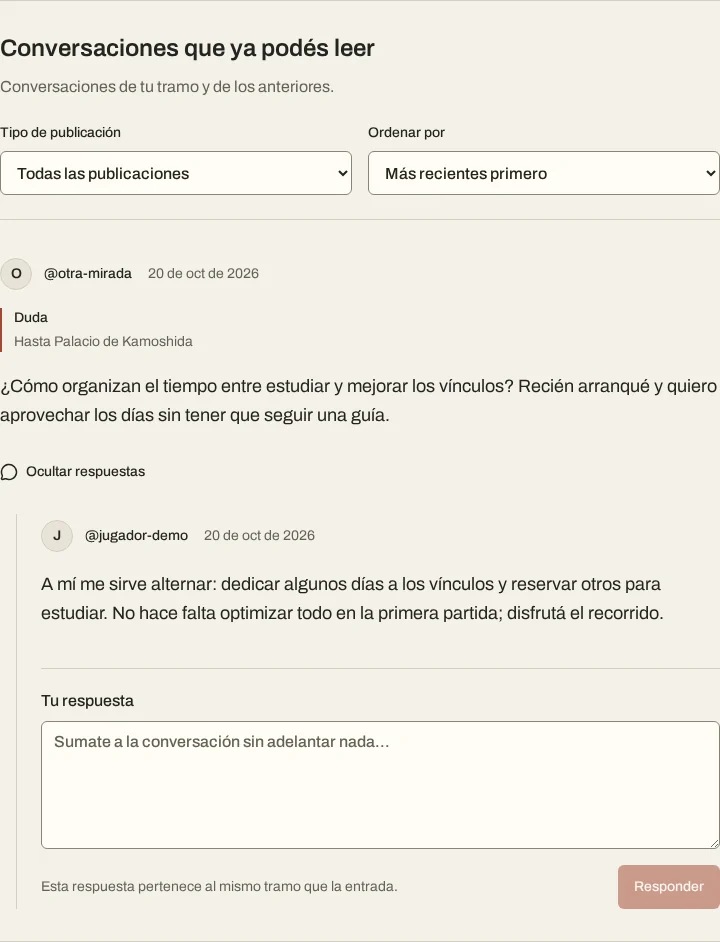
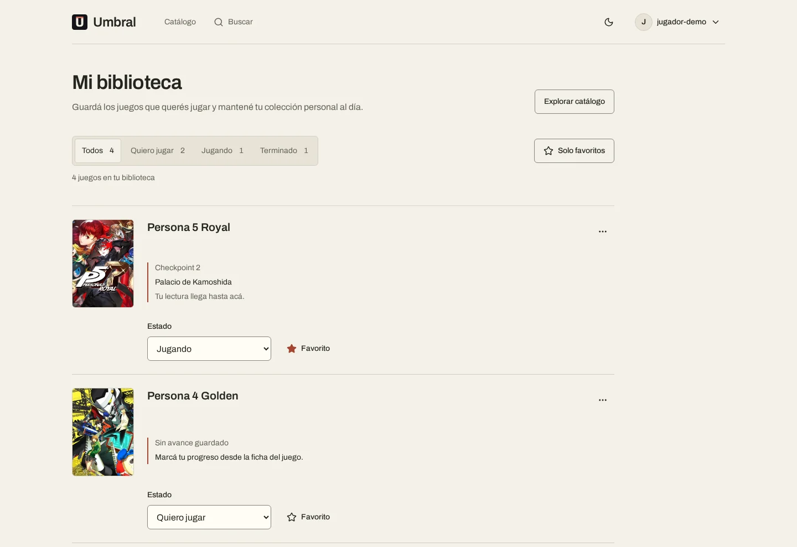

# Umbral

Comunidad para conversar sobre videojuegos narrativos, pedir ayuda y compartir
experiencias sin recibir spoilers de partes que todavía no jugaste.

**[Ver demo](https://umbral-facupompa.netlify.app)** ·
**[Ver releases](https://github.com/FacuPompa/Umbral/releases)**

Proyecto personal full stack en desarrollo, construido para consolidar
conocimientos de Java, Spring, seguridad web, persistencia y React.

## Cómo funciona

Cada juego se organiza en checkpoints narrativos. La persona registra hasta
dónde llegó y el backend utiliza ese progreso para determinar qué publicaciones
puede leer y dónde puede participar.

```text
Checkpoint de la publicación ≤ checkpoint alcanzado por el lector
```

La protección se aplica en Spring: el contenido que supera el progreso del
usuario **no se devuelve al navegador**. Las respuestas heredan la protección
de su publicación.

## Capturas

Interfaz real de Umbral. Las vistas privadas se capturaron con una cuenta y
contenido de demostración en una base aislada; no muestran datos personales
de usuarios reales. Las imágenes están optimizadas en WebP.

### Catálogo

Exploración de juegos disponibles para guardar progreso y participar.


### Conversaciones protegidas por progreso

Publicación y respuesta dentro del tramo habilitado por el progreso guardado.



### Biblioteca personal

Estados de juego, favoritos y acceso al progreso registrado.



## Funcionalidades

### Catálogo y comunidad

- Exploración pública del catálogo y las fichas de juegos.
- Búsqueda de juegos y perfiles de usuarios.
- Progreso individual por juego.
- Publicaciones clasificadas como reflexiones, dudas, teorías o reseñas.
- Edición de publicaciones propias, con indicador de edición.
- Respuestas directas para formar conversaciones en hilo.
- Feed con paginación, filtro por tipo y orden cronológico, siempre limitado
  por el progreso del lector.

### Perfil y biblioteca

- Perfil personal y perfil público.
- Biblioteca con estados **Quiero jugar**, **Jugando** y **Terminado**.
- Favoritos independientes del estado del juego.
- Métricas generales y favoritos en el perfil público, sin exponer correo ni
  progreso individual.
- Incorporación automática a la biblioteca al registrar progreso por primera vez.
- Quitar un juego de la biblioteca no elimina su progreso ni sus publicaciones.

### Propuestas y moderación

- Búsqueda de ediciones de juegos mediante RAWG para proponer incorporaciones
  al catálogo.
- Propuestas de checkpoints revisadas antes de habilitarse.
- Seguimiento de propuestas propias por estado y con paginación.
- Aprobación y rechazo de propuestas por cuentas moderadoras.
- Suspensión y reactivación de cuentas, conservando su contenido.
- Auditoría de creación y última modificación de juegos y checkpoints.

## Autenticación y seguridad

- Registro e inicio de sesión con contraseñas hasheadas mediante BCrypt.
- Autenticación con JWT y Spring Security, sin sesiones HTTP de autenticación.
- Access tokens de 10 minutos, conservados únicamente en memoria de React.
- Refresh tokens rotativos con vencimiento absoluto de 7 días, enviados mediante
  cookies `HttpOnly`.
- Almacenamiento de hashes de refresh tokens en PostgreSQL y detección de
  reutilización.
- Renovación automática del acceso al recargar la aplicación o vencer el JWT.
- Logout por dispositivo.
- Invalidación de accesos anteriores al cambiar contraseña o suspender una cuenta.
- Protección CSRF en las rutas que utilizan cookies y configuración CORS para
  el origen permitido.
- Autorización por roles `MEMBER` y `MODERATOR`. Las cuentas nuevas siempre se
  registran como miembros.

El catálogo y los perfiles públicos pueden explorarse sin autenticación. Las
acciones personales y las conversaciones protegidas requieren iniciar sesión.

## Stack

| Parte | Tecnologías |
| --- | --- |
| Backend | Java 26, Spring Boot 4, Spring Security, Spring Data JPA |
| Autenticación | JWT, Spring Security Resource Server y JOSE |
| Persistencia | PostgreSQL 17, Flyway |
| Frontend | React 19, React Router, JavaScript, Vite |
| Interfaz | Tailwind CSS 4, Radix UI, Lucide, Motion, Embla |
| Tests | JUnit, MockMvc, Testcontainers y Node.js |
| Infraestructura | Docker Compose, Netlify, Render y Supabase |
| CI | GitHub Actions para los tests del backend |

## Estructura del proyecto

```text
Umbral/
├── backend/       API REST, seguridad, persistencia y tests
├── frontend/      Aplicación React
├── docs/          Capturas y documentación de trabajo
├── docker-compose.yml
└── README.md
```

## Ejecutar localmente

### Requisitos

- JDK 26.
- Node.js compatible con Vite 8 y npm.
- Docker con Docker Compose.
- OpenSSL para generar la clave de firma JWT.

### 1. Configurar las variables

Desde la raíz del repositorio:

```bash
cp .env.example .env
openssl rand -base64 48
```

Copiá el resultado del segundo comando como valor de `UMBRAL_JWT_SECRET`
dentro de `.env`.

```properties
UMBRAL_JWT_SECRET=valor-generado-localmente
RAWG_API_KEY=tu-clave-de-rawg
```

La clave de RAWG se utiliza para buscar juegos al crear propuestas. Se consume
exclusivamente desde el backend.

Los archivos `.env` están ignorados por Git. No publiques claves reales ni
uses variables `VITE_` para secretos del backend.

### 2. Iniciar PostgreSQL

Desde la raíz:

```bash
docker compose up -d
```

### 3. Iniciar el backend

En otra terminal:

```bash
cd backend
./gradlew bootRun
```

Flyway aplica las migraciones pendientes al iniciar. Hibernate valida el
esquema y `data.sql` carga los datos iniciales.

### 4. Iniciar el frontend

En otra terminal:

```bash
cd frontend
npm ci
npm run dev
```

- Frontend: `http://localhost:5173`
- Backend: `http://localhost:8080`

El servidor de desarrollo de Vite redirige las peticiones `/api` al backend local.

## Verificación

Backend, con Docker disponible:

```bash
cd backend
./gradlew test
```

Los tests de integración utilizan un PostgreSQL temporal mediante
Testcontainers, separado de la base de desarrollo.

Frontend:

```bash
cd frontend
npm run check
```

Este comando ejecuta el análisis estático, los tests del cliente HTTP y el
build de producción.

GitHub Actions ejecuta los tests del backend en cada push y pull request.

## Despliegue

- **Netlify:** frontend.
- **Render:** backend mediante `backend/Dockerfile`.
- **Supabase:** PostgreSQL.

En Netlify, las peticiones `/api` se redirigen al backend mediante
`frontend/public/_redirects`. Para este despliegue, `VITE_API_BASE_URL` debe
permanecer sin definir o vacía.

El backend recibe estas variables:

```text
SPRING_DATASOURCE_URL
SPRING_DATASOURCE_USERNAME
SPRING_DATASOURCE_PASSWORD
UMBRAL_JWT_SECRET
UMBRAL_CORS_ALLOWED_ORIGIN
UMBRAL_SESSION_COOKIE_SECURE
UMBRAL_SESSION_COOKIE_SAME_SITE
RAWG_API_KEY
```

Con el proxy de Netlify, las cookies de producción utilizan `Secure=true` y
`SameSite=Lax`. Los nombres históricos `UMBRAL_SESSION_COOKIE_*` configuran
las cookies de renovación y CSRF; no implican autenticación mediante
sesiones HTTP.

Las migraciones de Flyway actualizan PostgreSQL al iniciar el backend.

La demo contempla la espera mientras el backend de Render vuelve a iniciar
tras un período de inactividad. La migración a JWT no elimina ese tiempo
de arranque.

## Alcance actual

Umbral es una aplicación funcional en evolución, centrada en conversaciones
sobre juegos con progreso narrativo lineal.

Los juegos y checkpoints propuestos requieren moderación. Las historias con
rutas ramificadas y múltiples finales todavía quedan fuera del modelo actual.

